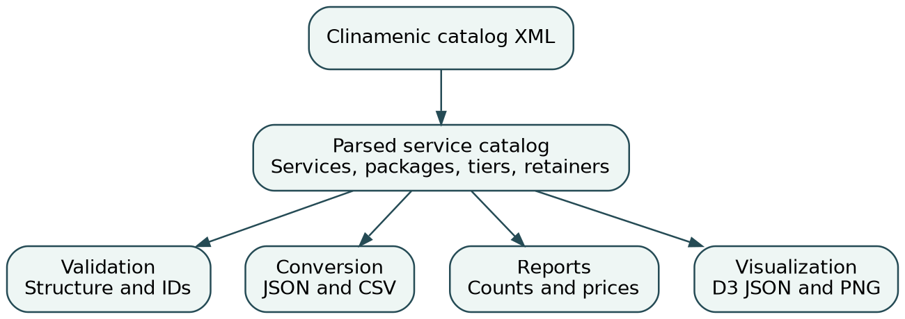

# Export workflow

The same parsed catalog feeds different outputs. The nested JSON view
preserves the service, package, tier and retainer hierarchy. Tier base
prices retain amounts and currencies. Retainer pricing can additionally
retain a frequency and minimum term. The CSV view spreads these record
types over separate files; IDs link rows across files. Neither view carries
all XML content. For example, tier discounts and retainer testimonials
are available in the source but omitted from both exports
[@service-processor; @clinamenic-catalog].

{width=72%}

The price summary computes per-currency statistics separately for tier
base prices and recurring retainer amounts. Within each group, the
headline range and average use the most common currency. Recurring
amounts are grouped without normalizing frequencies. The price chart
considers only tier base prices in the most common tier currency. The D3
export takes a narrower approach, emitting a service–package–tier tree
with base amounts on priced tiers but without currency labels
[@service-processor].
